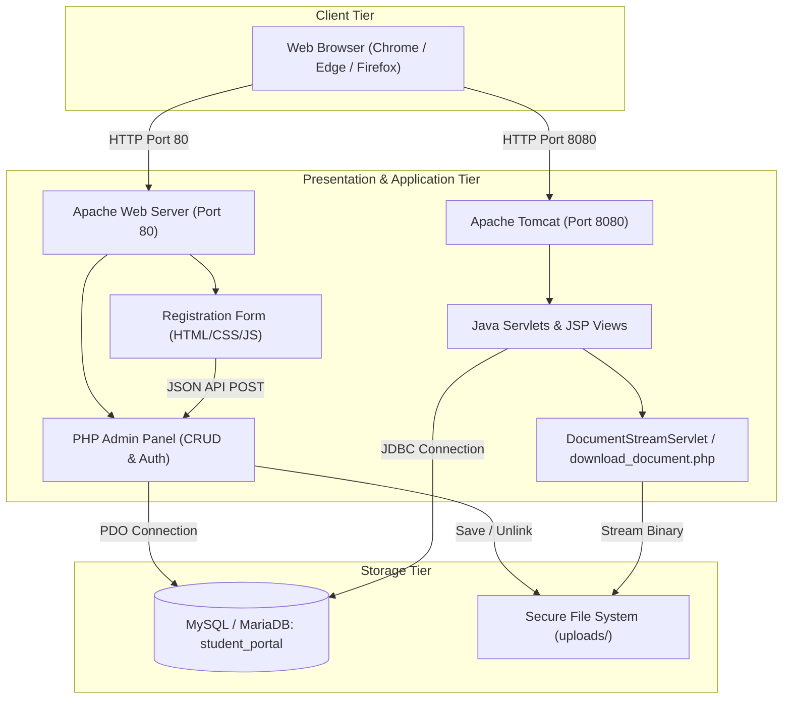

# Web Technology Individual Project Report: Student Admission Portal

---

## 1. Project Title
**ONLINE STUDENT ADMISSION & DOCUMENT MANAGEMENT PORTAL**  
*A Multi-Tier Web Application integrating HTML5/CSS3/JavaScript (CO3), PHP 8 & MySQL (CO4), and Jakarta Servlet/JSP on Apache Tomcat (CO5).*

---

## 2. Introduction
The Online Student Admission Portal is an enterprise-grade academic web application developed to streamline the student registration, credential verification, and administrative record management lifecycle in educational institutions. The application bridges client-side form validation, relational database storage, secure document streaming, and server-side business logic across two major enterprise web stacks: PHP/Apache and Java Servlet/JSP on Tomcat.

---

## 3. Objectives & Problem Statement

### Problem Statement
Traditional student admission processes rely on manual paper submissions or fragmented software that lacks real-time validation, proper file security, and unified data synchronization. Uploaded certificates and photographs are frequently stored insecurely, and administrative panels often lack defenses against common vulnerabilities such as SQL Injection, Cross-Site Scripting (XSS), Cross-Site Request Forgery (CSRF), and Path Traversal.

### Objectives
1. **CO3 (HTML5, CSS3, JavaScript):** Deliver a responsive, user-friendly registration form with real-time feedback, regular expression checks, an interactive 5-rule password strength tracker, and drag-and-drop file upload.
2. **CO4 (PHP & MySQL):** Implement an administrative dashboard supporting full CRUD (Create, Read, Update, Delete) operations, secure file uploads (PDF/Images), document metadata tracking, session management, and robust security defenses.
3. **CO5 (Java Servlet, JSP & JDBC):** Build a separate Java web application deployed on Apache Tomcat that connects to the same MySQL database via JDBC, retrieves student profiles and document metadata, streams files securely through a dedicated Servlet, and enforces session authorization.

---

## 4. Software and Hardware Requirements

### Software Requirements
- **Operating System:** Windows 10 / 11 (64-bit)
- **Web Servers:** Apache HTTP Server (via XAMPP) & Apache Tomcat 8.5+ / 9.0+
- **Server-Side Languages:** PHP 8.2+ and Java JDK 8 / 11 / 17 / 24
- **Database Engine:** MySQL 8.0+ / MariaDB 10.4+
- **Browsers Supported:** Google Chrome, Microsoft Edge, Mozilla Firefox
- **Development Tools:** Antigravity IDE / VS Code, javac, jar, phpMyAdmin

### Hardware Requirements
- **Processor:** Intel Core i3 / AMD Ryzen 3 or higher (x64)
- **RAM:** Minimum 4 GB (8 GB recommended for simultaneous Apache + Tomcat + MySQL execution)
- **Storage:** 500 MB free disk space

---

## 5. Technologies Used

- **Frontend:** HTML5, Vanilla CSS3 (Custom properties, Flexbox, Grid), JavaScript (ES6+, Fetch API, DOM manipulation).
- **PHP Backend:** PHP 8.2, PDO (PHP Data Objects), Bcrypt password hashing (`PASSWORD_BCRYPT`), `finfo` MIME validation.
- **Java Backend:** Jakarta / Java Servlet API 3.1 (`javax.servlet`), JavaServer Pages (JSP 2.3), JSTL 1.2, JDBC 4.2 (`com.mysql.cj.jdbc.Driver`).
- **Database:** MariaDB 10.4 / MySQL 8.0 with InnoDB engine and UTF-8 encoding (`utf8mb4_unicode_ci`).

---

## 6. System Architecture

---

## 7. Database Schema & Entity Relationships

The shared database `student_portal` consists of three normalized tables:

### 1. `admin_users` Table
Stores administrator credentials for both PHP Admin and Java Portal.
- `id` (INT, Primary Key, Auto Increment)
- `username` (VARCHAR 50, Unique, Indexed)
- `password_hash` (VARCHAR 255, Bcrypt hash)
- `full_name` (VARCHAR 100)
- `email` (VARCHAR 100, Unique)
- `role` (VARCHAR 20, Default 'admin')
- `created_at`, `updated_at` (TIMESTAMP)

### 2. `students` Table
Stores primary student registration details.
- `id` (INT, Primary Key, Auto Increment)
- `roll_number` (VARCHAR 30, Unique, Indexed)
- `name` (VARCHAR 100)
- `email` (VARCHAR 100, Unique, Indexed)
- `course` (VARCHAR 80)
- `password_hash` (VARCHAR 255, Bcrypt hash)
- `profile_image` (VARCHAR 255, Random stored filename)
- `status` (ENUM: 'Pending', 'Approved', 'Rejected')
- `registration_date`, `updated_at` (TIMESTAMP)

### 3. `student_documents` Table
Stores metadata for uploaded certificates, identity proofs, and profile photos.
- `id` (INT, Primary Key, Auto Increment)
- `student_id` (INT, Foreign Key referencing `students.id` ON DELETE CASCADE)
- `original_filename` (VARCHAR 255)
- `stored_filename` (VARCHAR 255, Unique, Indexed)
- `file_path` (VARCHAR 255)
- `mime_type` (VARCHAR 100)
- `file_size` (BIGINT)
- `document_category` (ENUM: 'profile_image', 'id_proof', 'certificate', 'other')
- `uploaded_at` (TIMESTAMP)

---

## 8. Detailed Module Walkthrough

### Module 1: Client-Side Registration (CO3)
- **Files:** `registration/index.html`, `registration/css/style.css`, `registration/js/validation.js`, `registration/register.php`.
- **Key Features:**
  1. Semantic HTML5 structure with clear field groups and required badges.
  2. Responsive design using CSS variables, custom media queries, and focus transitions.
  3. Real-time JavaScript validation: non-empty checks, RFC-compliant email regex, and duplicate prevention.
  4. 5-Rule Password Tracker verifying length (8+), uppercase, lowercase, numbers, and special characters.
  5. Drag-and-drop avatar file selector with client-side preview.
  6. Post-submission confirmation screen preventing blank-page syndrome.

### Module 2: PHP & MySQL Admin Dashboard & CRUD (CO4)
- **Files:** `php-admin/dashboard.php`, `add_student.php`, `edit_student.php`, `view_student.php`, `delete_student.php`, `upload_document.php`, `download_document.php`, `login.php`, `logout.php`, `config/database.php`, `includes/auth.php`.
- **Key Features:**
  1. Secure authentication verifying Bcrypt hashes against `admin_users`.
  2. Comprehensive student CRUD with duplicate roll number and email checks.
  3. Document upload subsystem validating 5MB limits, MIME types via `finfo`, and unguessable stored filenames.
  4. Safe cascade deletion removing both database records and physical disk files.
  5. CSRF token validation and XSS escaping across all forms.

### Module 3: Java Servlet, JSP & JDBC Portal (CO5)
- **Files:** `java-portal/src/main/java/com/studentportal/...` (`DBConnection.java`, `StudentDAO.java`, `DocumentDAO.java`, `AdminDAO.java`, `LoginServlet.java`, `StudentListServlet.java`, `StudentProfileServlet.java`, `DocumentStreamServlet.java`, `LogoutServlet.java`, `AuthFilter.java`, `BCrypt.java`), `login.jsp`, `students.jsp`, `profile.jsp`, `web.xml`, `pom.xml`.
- **Key Features:**
  1. Reusable `DBConnection` factory managing JDBC connections to MySQL.
  2. `StudentDAO` executing parameterized queries with `PreparedStatement` and `ResultSet` mapping.
  3. `AuthFilter` intercepting requests to protect private views.
  4. `DocumentStreamServlet` streaming profile images and documents with path traversal verification.
  5. Dynamic JSTL/EL rendering of student records, KPI cards, and document links.

---

## 9. Security Architecture

1. **Password Hashing:** Passwords are never stored in plaintext. They are hashed using the OpenBSD Blowfish algorithm (**BCrypt**) with a cost factor of 10.
2. **SQL Injection Defense:** All SQL queries in both PHP and Java use **Prepared Statements** with strict parameter binding.
3. **Cross-Site Scripting (XSS):** Dynamic outputs are escaped using `htmlspecialchars(..., ENT_QUOTES, 'UTF-8')` in PHP and `<c:out>` in JSP.
4. **Cross-Site Request Forgery (CSRF):** Form submissions include cryptographically random 32-byte tokens checked via `hash_equals()`.
5. **Session Fixation Defense:** Session IDs are regenerated upon successful login (`session_regenerate_id(true)` in PHP; session invalidation and creation in Java).
6. **Path Traversal Protection:** File streaming verifies canonical paths against the `uploads/` root directory to prevent directory climbing attacks (`../../`).
7. **Active Script Upload Defense:** Uploaded files receive randomized names (`std_...`), and executable extensions (`.php`, `.jsp`, `.exe`, `.sh`) are blocked from execution.

---

## 10. Viva Voce Preparation Guide

### Q1: How is the database shared between PHP and Java?
**Answer:** Both the PHP backend and Java Servlets connect to the exact same MySQL/MariaDB server instance on port 3306 and query the `student_portal` database. PHP connects via the PDO driver (`mysql:host=127.0.0.1;dbname=student_portal`), while Java connects using JDBC (`jdbc:mysql://127.0.0.1:3306/student_portal`). Changes made in one portal are immediately visible in the other.

### Q2: How do you prevent SQL Injection in both platforms?
**Answer:** In PHP, we use PDO prepared statements with parameter placeholders (e.g. `WHERE roll_number = :roll`) and disable emulation (`PDO::ATTR_EMULATE_PREPARES => false`). In Java, we use `java.sql.PreparedStatement` with `?` positional parameters. This ensures user input is treated strictly as data, never as executable SQL commands.

### Q3: How is document streaming secured against Path Traversal?
**Answer:** The streaming servlets and PHP scripts never accept arbitrary file paths from the user. Instead, they accept only primary key IDs or sanitized filenames, query the database metadata for the stored path, and verify that the canonical path (`realpath` / `getCanonicalPath`) begins with the authorized `uploads/` base directory.

### Q4: Why is BCrypt preferred over MD5 or SHA-256 for passwords?
**Answer:** BCrypt incorporates a random salt to protect against rainbow table attacks and is computationally slow with an adjustable work factor, making brute-force and GPU hardware attacks impractical.

---

## 11. Conclusion
The Student Admission Portal successfully delivers a unified, secure, and multi-tier academic management system satisfying all requirements of CO3, CO4, and CO5. By integrating client-side JavaScript validation, PHP administrative CRUD operations, and Java Servlet/JSP document streaming over a normalized MySQL schema, the application demonstrates robust architecture, seamless cross-platform data synchronization, and enterprise-grade web security.
